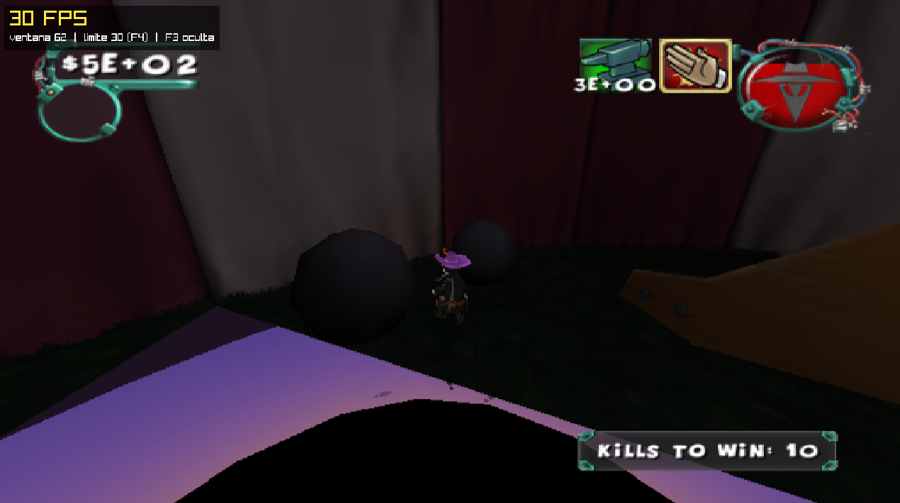
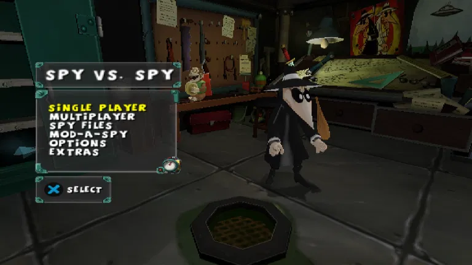
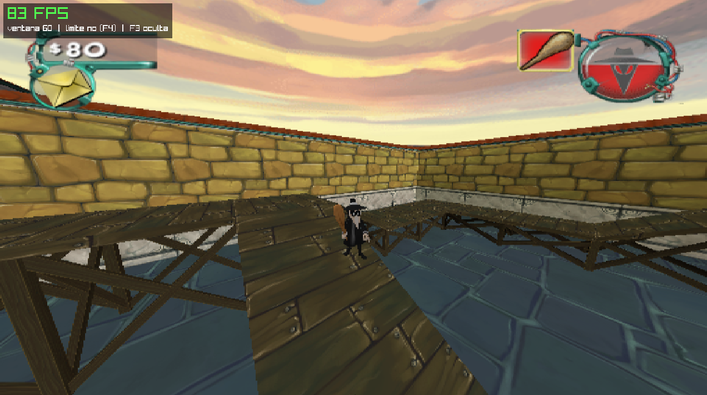
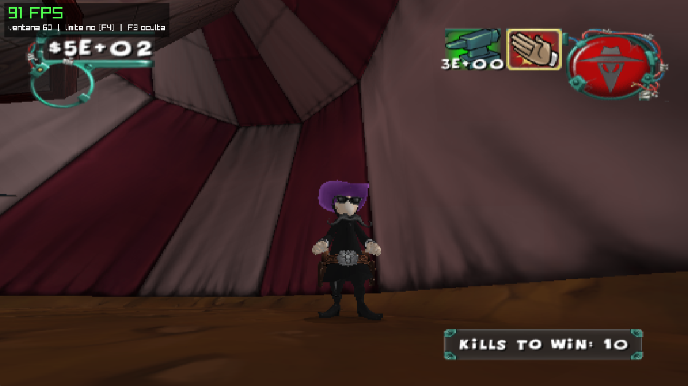

# Spy vs. Spy (PS2) — Static Recompilation PC Port

A native Windows port of **Spy vs. Spy** (PlayStation 2, 2005), made by statically recompiling the
game's MIPS code to C++ with [PS2Recomp](https://github.com/ran-j/PS2Recomp) and running it on a
patched PS2Recomp runtime with an OpenGL renderer.

**What is native and what is emulated:** the game's EE (main MIPS CPU) code — game logic, AI,
physics — is translated ahead of time to C++ and runs as native x86-64 code. The rest of the
console is still emulated or reimplemented: the VU1 vector unit (its microprograms can be translated
to C++, but they still model VU1 timing), the GS graphics chip (translated to OpenGL), VIF/DMA, the
IOP (its original modules run in an interpreter) and the SPU2 sound chip. This is the same model as
other recompilation ports (e.g. N64Recomp-based ones). In heavy scenes the VU1 emulation is the
performance bottleneck.

**The project is not actively maintained.** Issues and pull requests are welcome, but there is no
guarantee they will be answered. Forks are encouraged.

> **This repository contains no game code or data.** You need your own copy of the game
> (see [Supported version](#supported-version)). All game-derived files (the recompiled C++,
> the precompiled VU1 microcode, the disc files) are generated locally and are git-ignored.

**Status: playable.** Boots, menus, memory card, story mode, missions, music,
sound effects and movies work. Performance and some graphics issues remain (see [To do](#to-do)).

## Screenshots


| | |
|---|---|
|  |  |
|  |  |

## Supported version

Only the **European (PAL) release** is supported. The function map, overrides and fixes are tied
to this exact executable.

| | |
|---|---|
| Title | Spy vs. Spy (PAL, Europe) |
| Serial | **SLES-53078** (`SYSTEM.CNF`: `BOOT2 = cdrom0:\SLES_530.78;1`, `VER = 1.01`, `VMODE = PAL`) |
| ISO (4,495,048,704 bytes) | MD5 `e19bea8b89489556541503f29e163825` |
| `SLES_530.78` (3,347,164 bytes) | MD5 `032b00f673340701df5a77f5453fc2a5` · SHA-1 `f75da4362788b010e465503386b94094c756f2bd` |

Other regions (e.g. the US release) are **not** supported yet. `scripts/regenerate.ps1` warns if
your executable differs.

## Requirements (Windows 10/11, x64)

- **Visual Studio 2022 or newer** with *Desktop development with C++* and *C++ CMake tools for Windows*
- **Git** — https://git-scm.com
- **Python 3** (tick *Add to PATH*) — https://www.python.org
- **7-Zip** or any tool that can extract an ISO
- A GPU with **OpenGL 3.3** (integrated Intel/AMD graphics are fine)
- ~15 GB free disk space for the build folder (`C:\svs` by default, kept outside OneDrive on purpose)
- RAM: the build uses one compiler job per 3 GB of *free* RAM (it works with 2 GB free, just slower)

## Game files

Extract the **whole disc** into the `game/` folder of this repository, so you get:

```
game/
├── SLES_530.78
├── SYSTEM.CNF
├── DATA.PAK        (~990 MB, all levels, music and movies)
├── MODULES/        (IOP modules: .IRX)
├── CNF/
└── NETGUI/
```

With 7-Zip: right-click the ISO → *7-Zip → Extract files…* → choose the `game` folder.
The ISO itself is not used at runtime (you can keep it anywhere). Saves go to `game/mc0/`.

## Building

All scripts are PowerShell and run from the repository root:

```powershell
# 1. Generate the game's C++ from YOUR SLES_530.78 (builds PS2Recomp's recompiler, a few minutes)
powershell -ExecutionPolicy Bypass -File scripts\regenerate.ps1

# 2. Build the port (first build: 30-60 minutes; later builds only recompile what changed)
powershell -ExecutionPolicy Bypass -File scripts\build.ps1

# 3. Play
powershell -ExecutionPolicy Bypass -File scripts\run.ps1
```

Or just double-click **`build_and_run.bat`** after step 1.

### Optional: precompiled VU1 (recommended)

The VU1 coprocessor runs the game's 3D microprograms; it is the main CPU cost in heavy scenes.
`scripts\vu1-aot.ps1` starts the game in dump mode — play the menus and a level or two, close the
game — and then translates every VU1 program it saw into C++ (`generated\svs_vu1_aot.inc`).
Run `scripts\build.ps1` again to compile it in. Programs that were not dumped keep running in the
interpreter, so a partial dump is always safe. The translation was verified against the interpreter
on millions of executions with zero differences (`SVS_AOT_CHECK=1` repeats that check).

### Reproducibility

`regenerate.ps1` ends with `tools\verify_generated.py`, which fingerprints the generated code
(ignoring line endings). With the supported executable the result must be:

```
10126 files, fingerprint 8b4334d1b7e30022771e2e29f430041cfa604a36
OK: identical to the reference build.
```

### Day-to-day scripts

| Task | Script | Time |
|---|---|---|
| Generate game C++ from the ELF | `scripts\regenerate.ps1` | few min |
| Full build / after pulling a new patch | `scripts\build.ps1` | 30-60 min first, then minutes |
| Rebuild after editing `overrides\svs_overrides.cpp` | `scripts\quick.ps1` (builds + runs) | 1-3 min |
| Play | `scripts\run.ps1` (log: `C:\svs\game.log`) | — |
| Precompile VU1 microprograms | `scripts\vu1-aot.ps1` | play a few minutes |
| GPU/renderer diagnostics for bug reports | `scripts\diagnose.ps1 <1-9>` | — |

Set `SVS_WORK` to use a build folder other than `C:\svs`.

## Controls

A gamepad (XInput/DirectInput) is detected automatically. Keyboard:

| PS2 | Keyboard |
|---|---|
| Left stick (move) | W A S D |
| Right stick (camera) | I J K L |
| D-pad | Arrow keys |
| ✕ / ○ / □ / △ | X or Space / C or Esc / Z / V |
| L1 / R1 / L2 / R2 | Q / E / Left Shift / Right Shift |
| Start / Select | Enter / Tab |

| Hotkey | |
|---|---|
| F3 | Show/hide the FPS counter |
| F4 | Toggle the 30 fps cap (on by default) |
| F11 or Alt+Enter | Fullscreen |
| F1 | Runtime debugger |

## Features

- **GPU renderer** (OpenGL 3.3): specialized shaders per GS state, hardware texture sampling,
  render-to-texture, frames shown directly from GPU textures (no read-back). `SVS_RENDERER=cpu`
  switches to the multi-threaded software rasterizer.
- **Widescreen**: the window takes the monitor's aspect ratio (4:3 to 21:9) and the game camera
  widens its horizontal field of view instead of stretching. `SVS_ASPECT=16:9` forces a ratio,
  `SVS_ASPECT=4:3` keeps the original.
- **Audio**: SPU2 emulation (48 ADPCM voices, ADSR, DMA, IRQ) for music and sound effects, plus the
  movies' audio track decoded from the PSS streams.
- **Threads**: game logic (EE), GS/VU1 (3D microprograms + GS command processing) and the window/GPU
  each run on their own thread.
- **On-screen FPS counter** and a 30 fps cap.

## To do

Known issues and planned work (help welcome):

- [ ] **Frame drops in heavy scenes** — the GS/VU1 thread is the bottleneck (2+ million VU1
      instructions per frame); scenes drop to ~20 fps on a 14-thread laptop. Next steps: faster
      VU1 code generation, splitting VU1 and GS processing across threads.
- [ ] **60 fps mode** (the game targets 30).
- [ ] **Objects flickering** (appearing/disappearing between frames).
- [ ] **HUD numbers in scientific notation** (`$5E+02` instead of `$500`, `3E+00` instead of `3`).
- [ ] **PC controls**: rebindable keys, mouse camera.
- [ ] SPU2 reverb (sound is "dry").
- [ ] Online mode (DEV9 network adapter, DNAS, GameSpy).
- [ ] US (NTSC) release support.
- [ ] Linux / macOS / Android builds (the runtime builds on Linux; scripts and packaging are missing).

## Repository layout

```
├── README.md
├── LICENSE                     GPL-3.0 (same as PS2Recomp)
├── build_and_run.bat           build.ps1 + run.ps1
├── scripts/                    regenerate / build / quick / run / vu1-aot / diagnose (PowerShell)
├── patches/
│   ├── ps2recomp-svs.patch     runtime fixes and features on top of PS2Recomp e563698
│   └── ps2xrecomp-sqrt.patch   recompiler fix (SQRT.S operand); tools/fix_sqrt.py does the same post hoc
├── recomp/
│   ├── spyvsspy.toml           PS2Recomp config (131 library stubs)
│   ├── functions.csv           function map (addresses/sizes, from tools/fix_functions_csv.py)
│   └── obsolete_files.txt      leftovers from older generations, ignored by the build
├── overrides/svs_overrides.cpp game-specific fixes (C++ replacements for some game functions)
├── tools/                      Python: function map, post-processing, VU1 AOT generator, verifier
├── docs/screenshots/           images for this README
├── game/        (ignored)      your extracted disc
└── generated/   (ignored)      recompiled C++ and precompiled VU1, made from your copy
```

## What the runtime patch fixes

Most fixes are generic PS2Recomp bugs that should help other games too. Highlights:

- **Kernel/BIOS**: `StartThread` return value; COP0 Count advancing (movies can be skipped);
  nested guest call/return tracking (`missing pc=0x3` crashes).
- **IOP**: module `argc/argv`, `ioman` file I/O, `sceSifSetDmaIntr`, RPC handlers running on real IOP
  threads, `sceSifGetOtherData` (sound banks were uploaded empty), 8 MB IOP RAM and a working
  `sceSifFreeIopHeap`, batched EE/IOP synchronization (2.5× faster).
- **SPU2**: new emulation (the real LIBSD/IOMGR drivers run on the emulated IOP).
- **GS/GIF/VIF**: ZTE=0, `sceGsResetGraph` register writes, PATH3 ordering and masking, DMA chains
  longer than 4096 tags, `UNPACK V4-5` color expansion, CVT.W.S truncation (missing room geometry).
- **VU1**: fast interpreter path, MAC-flag liveness, content-addressed decode cache, AOT compiler.
- **Movies**: shared virtual disc for EE/IOP streaming, end-of-stream code, audio track.
- **Memory card**: `GetDir` continuation (endless "Checking memory card").
- **Renderer**: OpenGL backend; single GL context (fixes garbage output on Intel drivers).

## Debugging

Useful environment variables (set them before `scripts\run.ps1`):

| Variable | Effect |
|---|---|
| `SVS_FPS=1`, `SVS_GL_STATS=1` | FPS, VU1 and GPU statistics in the log every 2 s (on in `run.ps1`) |
| `SVS_FPS_LIMIT=0` | Start without the 30 fps cap |
| `SVS_RENDERER=cpu` | Software renderer |
| `SVS_GS_THREAD=0` | Run VU1/GS on the game thread (no GS thread) |
| `SVS_GL_THREAD=1` | Old GPU path: separate GL thread with its own context |
| `SVS_VU_AOT=0` / `SVS_VU_FASTPATH=0` | Disable the precompiled VU1 / the fast interpreter path |
| `SVS_AOT_CHECK=1` | Compare every precompiled VU1 run against the interpreter |
| `SVS_MUS_TRACE=1` | Log which music track plays and when |
| `SVS_RPC_TRACE=1`, `SVS_IOP_TRACE=1` | EE↔IOP RPC and IOP import calls / IOP scheduler |
| `SVS_SPU2_TRACE=1`, `SVS_SPU2_RAW=file.raw` | SPU2 voices and DMA / raw 48 kHz output dump |
| `SVS_MPEG_TRACE=1` | Movie player |
| `SVS_VIF_TRACE=1`, `SVS_PRIM_TRACE=1` | VIF/VU1 traffic / GS primitive summary |
| `SVS_TRACE_CALLS=0x256e48,...` | Count calls to game functions (up to 8 addresses) |

If the game crashes, the log shows `[svs] missing pc=… thread=… hist:` with the thread's last functions.

## Credits and license

- [PS2Recomp](https://github.com/ran-j/PS2Recomp) by ran-j and contributors — the recompiler and runtime
  this port is built on. Licensed under **GPL-3.0**; the patch in this repository is a modification of
  it and is distributed under the same license (see `LICENSE`).
- raylib, Dear ImGui, rlImGui, FFmpeg (fetched by PS2Recomp's build).
- Spy vs. Spy is © its respective owners. This project is not affiliated with or endorsed by them,
  and it does not distribute any of the game's code or assets.
